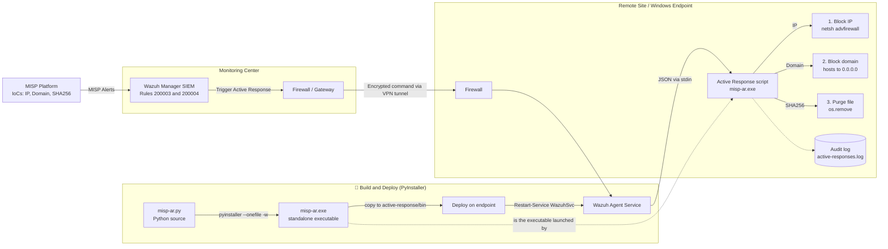

🛡️ MISP + Wazuh Active Response: Automated Threat Mitigation
> Automating cyber defense: Wazuh consumes **MISP** threat intelligence and a custom Python Active Response script blocks malicious IPs, sinkholes malicious domains and purges malicious files on Windows endpoints, with no manual intervention.


---
📌 Overview
Manual response to threat intelligence is slow. This project closes the gap between detection and response by integrating:
MISP (Malware Information Sharing Platform): source of Indicators of Compromise (IoCs)
Wazuh (SIEM/XDR): correlates events with MISP IoCs and triggers Active Response
A custom Python script (`misp-ar`), compiled to `.exe` with PyInstaller, that executes the mitigation on the endpoint
IoC type (MISP)	Automated action	Mechanism
`ip-src` / IP address	Block inbound traffic	Windows Firewall rule via `netsh`
`domain`	Sinkhole the domain	Redirect to `0.0.0.0` in the `hosts` file
`sha256`	Delete the malicious file	`os.remove()` on the detected path
Every action and error is written to an audit log (`active-responses.log`).
🏗️ Architecture
The diagram covers both the build/deploy pipeline (Python script → PyInstaller → `.exe` → agent) and the runtime detection/response flow.

> 💡 The original lab diagram is kept in `docs/architecture.png`.
📁 Repository Structure
```
.
├── .github/workflows/
│   └── build.yml             # CI: builds misp-ar.exe with PyInstaller
├── src/
│   └── misp-ar.py            # Active Response script
├── config/
│   ├── ossec.conf.snippet    # <command> + <active-response> blocks (manager)
│   └── local_rules.xml       # Custom rules 200003 / 200004 (manager)
├── docs/
│   └── architecture.png      # Original lab diagram
├── build.ps1                 # One-command PyInstaller build (+ optional deploy)
├── requirements-build.txt    # PyInstaller dependency
├── LICENSE
└── README.md
```
📂 Project Files
File	Description
`src/misp-ar.py`	Active Response script (source code)
`config/local_rules.xml`	Custom Wazuh rules `200003` (domain) and `200004` (SHA256)
`config/ossec.conf.snippet`	Wazuh manager `<command>` and `<active-response>` configuration
`build.ps1`	PyInstaller build and deploy script
`.github/workflows/build.yml`	CI pipeline that builds `misp-ar.exe`
🚀 Setup
1. Endpoint (Windows agent): build with PyInstaller
PyInstaller bundles the Python script and its interpreter into a single `.exe`, so the endpoint does not need Python installed.
Option A: one command (recommended)
```powershell
.\build.ps1            # build only -> dist\misp-ar.exe
.\build.ps1 -Deploy    # build + copy to the agent + restart service (run as Administrator)
```
Option B: manual steps
```powershell
pip install -r requirements-build.txt

# --onefile: single standalone .exe   |   -w: no console window
pyinstaller.exe --onefile -w --name misp-ar src\misp-ar.py

Copy-Item .\dist\misp-ar.exe "C:\Program Files (x86)\ossec-agent\active-response\bin\"
Restart-Service WazuhSvc
```
Option C: download from CI: every push builds the executable on GitHub Actions (`.github/workflows/build.yml`). Grab `misp-ar.exe` and its `.sha256` from the Actions artifacts, or from Releases when you push a tag:
```bash
git tag v1.0.0 && git push origin v1.0.0
```
> 🔐 Verify the checksum before deploying: `Get-FileHash .\misp-ar.exe -Algorithm SHA256`
2. Wazuh manager
Add the configuration from `config/ossec.conf.snippet` to `/var/ossec/etc/ossec.conf`
Add the rules from `config/local_rules.xml` to `/var/ossec/etc/rules/local_rules.xml`
Restart the manager:
```bash
   sudo service wazuh-manager restart
   ```
> The rules depend on parent rule `100622` (the MISP integration rule), so the MISP ↔ Wazuh integration must already be in place.
🧪 Testing
Open the Wazuh dashboard → Threat Intelligence → Threat Hunting → Events
On the Windows endpoint, trigger a MISP-listed domain:
```powershell
   ping office.oiqezet.com
   ```
Verify the response:
```powershell
   Get-Content "C:\Program Files (x86)\ossec-agent\active-response\active-responses.log" -Tail 20
   Select-String "office.oiqezet.com" C:\Windows\System32\drivers\etc\hosts
   ```
Expected: the alert appears in Wazuh, the log shows a successful execution, and the domain resolves to `0.0.0.0`.
📈 Results
⏱️ Response time reduced from manual triage to seconds
🔁 Fully automated pipeline: MISP → Wazuh → Endpoint
🧾 Full audit trail of every automated action
🔮 Possible Improvements
Add a dedicated rule for `ip-src` IoCs
Auto-expire blocks (the manager sends a `delete` command after the timeout, already handled by the script)
Quarantine files instead of deleting them
Cross-platform version for Linux endpoints (`iptables` / `nftables`)
Send results back to MISP as sightings
⚠️ Disclaimer
For educational and lab use. Test in an isolated environment before any production deployment: automated blocking and deletion can cause false-positive outages. Never commit real credentials or internal IP addresses.
📄 License
MIT. See LICENSE.
👤 Author
Your Name: GitHub · LinkedIn
