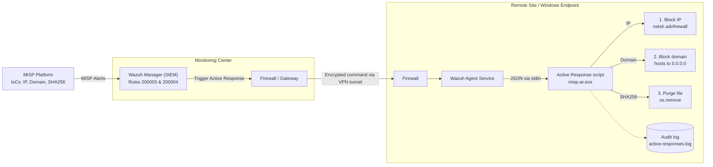

# 🛡️ MISP + Wazuh Active Response: Automated Threat Mitigation

> Automating cyber defense: Wazuh consumes **MISP** threat intelligence and a custom Python Active Response script blocks malicious IPs, sinkholes malicious domains and purges malicious files on Windows endpoints, with no manual intervention.


---

## 📌 Overview

Manual response to threat intelligence is slow. This project closes the gap between **detection** and **response** by integrating:

- **MISP** (Malware Information Sharing Platform): source of Indicators of Compromise (IoCs)
- **Wazuh** (SIEM/XDR): correlates events with MISP IoCs and triggers Active Response
- **A custom Python script** (`misp-ar`), compiled to `.exe` with PyInstaller, that executes the mitigation on the endpoint

| IoC type (MISP) | Automated action | Mechanism |
|---|---|---|
| `ip-src` / IP address | Block inbound traffic | Windows Firewall rule via `netsh` |
| `domain` | Sinkhole the domain | Redirect to `0.0.0.0` in the `hosts` file |
| `sha256` | Delete the malicious file | `os.remove()` on the detected path |

Every action and error is written to an audit log (`active-responses.log`).

## 🏗️ Architecture



> 💡 Tip: add your own diagram image to `docs/architecture.png` and reference it here.


```

## ⚙️ How the script works (`src/misp-ar.py`)

| Function | Role |
|---|---|
| `write_log()` | Records every action/error to `active-responses.log` |
| `delete_file()` | Checks the file exists and removes it; logs failures instead of crashing |
| `block_ip()` | Creates an inbound-block Windows Firewall rule with `netsh advfirewall` |
| `block_domain()` | Appends `0.0.0.0 <domain>` to `C:\Windows\System32\drivers\etc\hosts` |
| `main()` | Reads the Wazuh JSON alert from `stdin`, extracts the IoC type/value and dispatches the action |

Security hardening included: strict validation of IPs, domains and hashes before use, and `subprocess` called with argument lists (no shell), which prevents command injection from untrusted IoC values.

## 🚀 Setup

### 1. Endpoint (Windows agent)

```powershell
# Install dependency to build the executable
pip install pyinstaller

# Build a standalone .exe (no Python required on the endpoint)
pyinstaller.exe --onefile -w src\misp-ar.py

# Deploy
Copy-Item .\dist\misp-ar.exe "C:\Program Files (x86)\ossec-agent\active-response\bin\"

# Restart the agent
Restart-Service WazuhSvc
```

### 2. Wazuh manager

1. Add the contents of [`config/ossec.conf.snippet`](config/ossec.conf.snippet) to `/var/ossec/etc/ossec.conf`
2. Add the rules from [`config/local_rules.xml`](config/local_rules.xml) to `/var/ossec/etc/rules/local_rules.xml`
3. Restart:
   ```bash
   sudo service wazuh-manager restart
   ```

> Rules `200003` and `200004` use parent rule `100622` (the MISP integration rule), so the MISP ↔ Wazuh integration must already be in place.

## 🧪 Testing

1. Open the Wazuh dashboard → **Threat Intelligence → Threat Hunting → Events**
2. On the Windows endpoint, trigger a MISP-listed domain:
   ```powershell
   ping office.oiqezet.com
   ```
3. Verify the response:
   ```powershell
   Get-Content "C:\Program Files (x86)\ossec-agent\active-response\active-responses.log" -Tail 20
   Select-String "office.oiqezet.com" C:\Windows\System32\drivers\etc\hosts
   ```

Expected: the alert appears in Wazuh, the log shows a successful execution, and the domain resolves to `0.0.0.0`.

## 📈 Results

- ⏱️ Response time reduced from manual triage to **seconds**
- 🔁 Fully automated pipeline: **MISP → Wazuh → Endpoint**
- 🧾 Full audit trail of every automated action

## 🔮 Possible Improvements

- Add a dedicated rule for `ip-src` IoCs
- Auto-expire blocks (the manager sends a `delete` command after the timeout, already handled by the script)
- Quarantine files instead of deleting them
- Cross-platform version for Linux endpoints (`iptables` / `nftables`)
- Send results back to MISP as sightings

## ⚠️ Disclaimer

For **educational and lab use**. Test in an isolated environment before any production deployment: automated blocking and deletion can cause false-positive outages. Never commit real credentials or internal IP addresses.

## 📄 License

MIT. See [LICENSE](LICENSE).

## 👤 Author

**Your Name**: [GitHub](https://github.com/your-username) · [LinkedIn](https://linkedin.com/in/your-profile)
